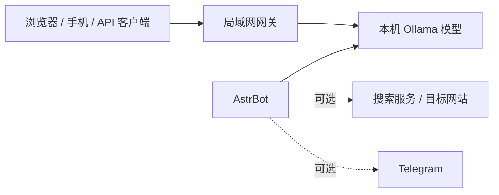

<h1 align="center">小九 · 本地 AI 工作台</h1>

<strong>把本地模型带到浏览器、手机和局域网设备上。</strong>

Ollama · AstrBot · 局域网 API · Windows

  <a href="功能与使用指南.md">功能指南</a> ·
  <a href="07-局域网API.md">局域网 API</a> ·
  <a href="LICENSE">MIT License</a>

---

小九是一套围绕本地 Ollama 模型搭建的个人 AI 工作台。它把聊天界面、设备接入、运行状态和可选联网工具放在一起，适合希望自己管理模型与数据流的 Windows 用户。

## 你可以用它做什么

| 本地聊天 | 手机接入 | 运行状态 | 按需联网 |
| --- | --- | --- | --- |
| 通过 AstrBot 使用本机模型 | 网关提供网页控制台与 OpenAI 兼容 API | 查看 CPU、内存、显存、GPU 和模型状态 | 可选搜索和网页读取，并明确标出数据会发往外部服务 |

## 运行结构

## 开始使用

1. 准备 Windows 10/11、Python 3.12+、Ollama、AstrBot 和兼容的模型权重。
2. 查看[功能与使用指南](功能与使用指南.md)，按需配置本机模型和服务。
3. 使用 `启动AstrBot.bat` 打开本机聊天界面；需要手机或其他设备时，再启动 `启动局域网API.bat`。
4. 阅读[局域网 API 指南](07-局域网API.md)，了解客户端连接、鉴权和网络边界。

本仓库提供的是源码与配置示例，不包含模型权重、运行时、访问凭据、聊天备份或个人角色设定。模型需要单独获取；本地 `Modelfile` 中的模型路径也需按自己的安装位置调整。

## 数据流与隐私

| 功能 | 数据流向 |
| --- | --- |
| 本机模型推理 | 请求发送到本机 Ollama |
| 网页搜索 | 搜索词发送到已配置的搜索服务 |
| 网页读取 | 访问目标网站；对方可看到请求来源 |
| Telegram | 消息经过 Telegram 服务 |
| 网关日志 | 留存在运行设备，记录请求路径、来源地址、客户端类型和结果状态 |
| 会话记忆 | 默认关闭；启用后消息与摘要保存在本机 |

局域网网关默认使用未加密的 HTTP，聊天 API 默认不强制 API Key。只在可信局域网使用，不要映射到公网。启用联网工具或第三方聊天平台后，相关数据会离开本机。

## 项目内容

- `ollama_gateway.py` 与 `gateway_page.py`：局域网网关和浏览器控制台
- `plugins/`：AstrBot 网页读取与人格路由插件
- `Modelfile*`：本地模型配置示例
- `scripts/`：维护脚本副本
- `交付包/`：安装辅助脚本、插件与模型配置

可选 APK 下载目录默认为项目根目录下的 `apk/`；也可在启动前设置 `LOCAL_AI_APK_DIR` 指向其他目录。

欢迎提交问题和改进建议。发布前请不要添加运行时配置、API Key、Bot Token、设备授权文件、个人角色卡或聊天记录。
